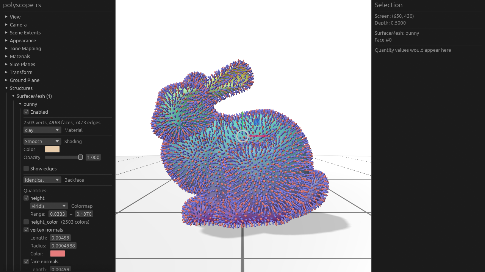
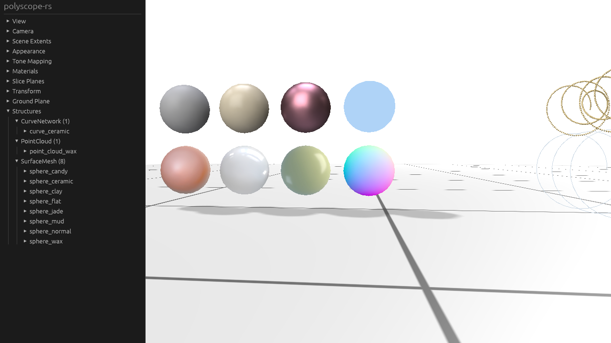
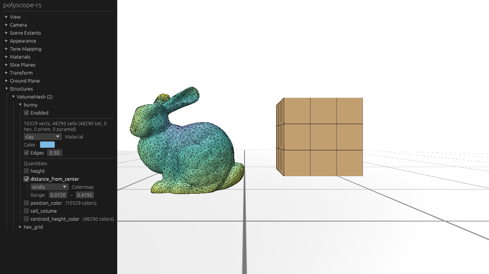
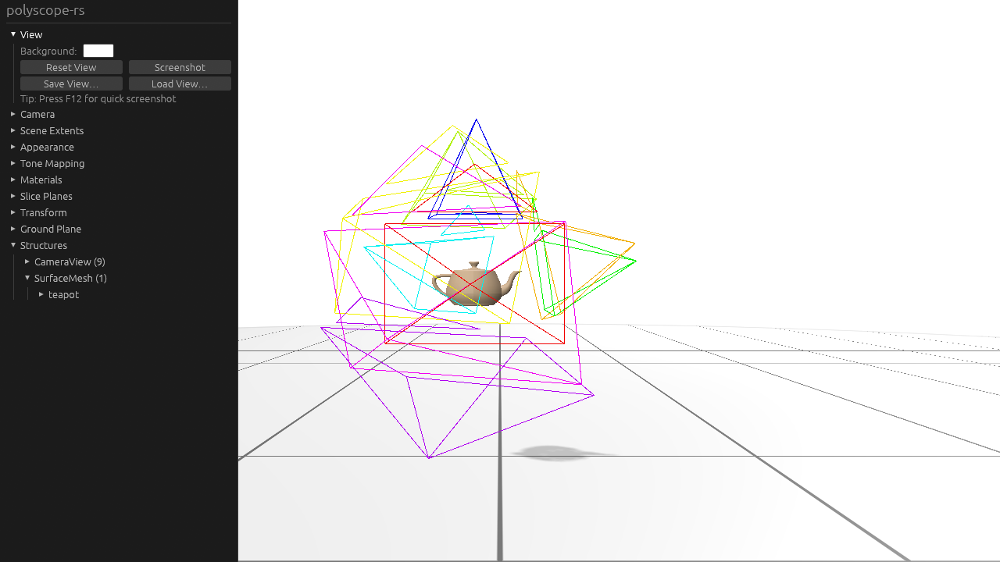
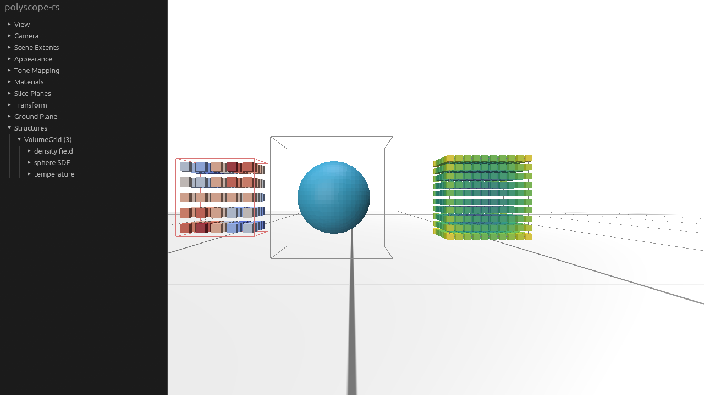

# polyscope-rs



A Rust-native 3D visualization library for geometric data, inspired by [Polyscope](https://polyscope.run).

[](https://opensource.org/licenses/MIT)

<table>
  <tr>
    <td align="center"><br><b>Materials</b></td>
    <td align="center"><br><b>Volume Mesh</b></td>
  </tr>
  <tr>
    <td align="center"><br><b>Camera View</b></td>
    <td align="center"><br><b>Volume Grid</b></td>
  </tr>
</table>

## Overview

polyscope-rs is a viewer and user interface for 3D data such as meshes and point clouds. You register your data, and polyscope-rs shows it. You can change the visualization in code or in the GUI.

This is a Rust reimplementation of the original C++ [Polyscope](https://github.com/nmwsharp/polyscope) library. It uses Rust graphics libraries (wgpu, winit, egui).

## Disclaimer

This project is an experiment in **AI-driven software development**. I have limited Rust experience but have used [Polyscope](https://polyscope.run) extensively and contributed PRs to the original C++ library. It validates the hypothesis that languages with **informative compiler feedback** (like Rust) work better with AI-assisted development.

**Note:** This project does not have full feature parity with C++ Polyscope 2.x yet. Contributions and feedback are welcome in the [Discussions](https://github.com/xarthurx/polyscope-rs/discussions) section.

## Project Status

**Current Version:** 0.6.3

**Status:** polyscope-rs ports the main structures and quantities of C++ Polyscope 2.x, but not its complete API. The largest gaps:

- No per-frame user callback and no global camera API.
- Floating images are stored but not displayed.
- Scalar quantities have no `DataType`, no isolines and no on-screen colorbar.
- No Sparse Volume Grid and no SimpleTriangleMesh.

[Feature Status & Roadmap](docs/feature-status.md) lists each gap, each difference from C++ Polyscope and the roadmap.

### What's Working

| Feature | Status |
|---------|--------|
| Point Clouds | ✅ Scalar, vector and color quantities |
| Surface Meshes | ✅ Triangles + arbitrary polygons; scalar, color, vector, parameterization, intrinsic vector and one-form quantities |
| Curve Networks | ✅ Lines or tubes; node and edge scalar, color and vector quantities |
| Volume Meshes | ✅ Tet/Hex/Prism/Pyramid cells; vertex and cell scalar, color and vector quantities |
| Volume Grids | ✅ Node/cell scalars, gridcube or isosurface (marching cubes) |
| Camera Views | ✅ Frustum widget, "fly to" from the UI |
| Materials | ✅ 8 built-in + custom material loading |
| Color Maps | ✅ The 15 built-in maps of C++ Polyscope |
| Ground Plane | ✅ Tile/Shadow/Reflection, follows the up direction |
| Slice Planes | ✅ Up to 4 active planes |
| Groups | ✅ Hierarchical |
| Gizmos | ✅ Translate/Rotate/Scale, snap increments |
| Transparency | ✅ Depth peeling (Pretty) + alpha blending (Simple) |
| Tone Mapping | ✅ HDR pipeline |
| SSAO | ✅ Ambient occlusion (polyscope-rs only) |
| RGBA Colors | ✅ Per-element alpha on surface mesh color quantities |
| Headless Rendering | ✅ `render_to_image()` / `render_to_file()` without a window |
| Screenshots | ✅ PNG/JPEG export, transparent background |
| Picking | ✅ Structure/Element selection with the C++ click rules |
| Camera Navigation | ✅ Turntable/Free/Planar/Arcball/First-person/None |
| View Save/Restore | ✅ Camera and render look to a JSON file (Rust-native format) |
| Parameterization | ✅ Checker/Grid/LocalCheck/LocalRad styles |
| Intrinsic Vectors | ✅ Tangent-space with symmetry |
| One-Forms | ✅ Edge-based differential forms |
| Floating Quantities | 🔄 Scalar/color images are stored, but not displayed yet |

See [docs/architecture-differences.md](docs/architecture-differences.md) for a detailed comparison with C++ Polyscope.

## Features

- **Point Clouds** - Visualize point sets with scalar, vector, and color quantities
- **Surface Meshes** - Render triangle and polygon meshes with scalars, vectors, colors, parameterization, intrinsic vectors, and one-forms
- **Curve Networks** - Display networks of nodes and edges as lines or tubes
- **Volume Meshes** - Visualize meshes of tetrahedra, hexahedra, prisms and pyramids
- **Volume Grids** - Render regular 3D grids with node/cell scalar quantities
- **Camera Views** - Visualize camera frustums and poses
- **Slice Planes** - Cut through geometry to see interiors
- **Groups** - Organize structures hierarchically
- **Gizmos** - Interactive transform manipulation
- **View Save/Restore** - Save the camera and the render look to JSON, and load them again

## Quick Start

```rust
use polyscope_rs::*;

fn main() -> Result<()> {
    // Initialize polyscope
    init()?;

    // Register a point cloud
    let points = vec![
        Vec3::new(0.0, 0.0, 0.0),
        Vec3::new(1.0, 0.0, 0.0),
        Vec3::new(0.0, 1.0, 0.0),
    ];
    let pc = register_point_cloud("my points", points);

    // Add a scalar quantity
    pc.add_scalar_quantity("height", vec![0.0, 0.5, 1.0]);

    // Show the viewer
    show();

    Ok(())
}
```

## Headless Rendering

Render scenes without a window, for batch processing, automated tests and server-side rendering:

```rust
use polyscope_rs::*;

fn main() -> Result<()> {
    init()?;

    register_point_cloud("pts", vec![Vec3::ZERO, Vec3::X, Vec3::Y]);

    // Render to pixel buffer (RGBA, 4 bytes per pixel)
    let pixels = render_to_image(800, 600)?;

    // Or render directly to a PNG file
    render_to_file("output.png", 800, 600)?;

    Ok(())
}
```

## Installation

Add to your `Cargo.toml`:

```toml
[dependencies]
polyscope-rs = "0.6"
```

Requirements:

- Rust 1.96 or later.
- A graphics driver with Vulkan, Metal or DirectX 12. The OpenGL backend of wgpu is not supported.

`polyscope_rs` re-exports `Vec2`, `Vec3`, `Vec4` and `Mat4` from glam. For other glam types, such as `glam::UVec3`, also add `glam = "0.34"`.

## Demos

Run any demo with:

```bash
cargo run --example <demo_name>
```

| Demo | Command | Description |
|------|---------|-------------|
| Point Cloud | `cargo run --example point_cloud_demo` | Scalar, vector, and color quantities on point sets |
| Surface Mesh | `cargo run --example surface_mesh_demo` | Stanford Bunny with scalar, color, vector, parameterization, intrinsic vector and one-form quantities |
| Curve Network | `cargo run --example curve_network_demo` | Curve and edge networks with node and edge quantities |
| Volume Mesh | `cargo run --example volume_mesh_demo` | Tet/hex meshes with interior face detection and quantities |
| Volume Mesh (mixed cells) | `cargo run --example volume_mesh_mixed_cells_demo` | Tet, hex, prism and pyramid cells side by side |
| Volume Grid | `cargo run --example volume_grid_demo` | Gridcube mode, isosurface (marching cubes), cell scalars |
| Camera View | `cargo run --example camera_view_demo` | Camera frustum visualization |
| Slice Planes | `cargo run --example slice_plane_demo` | Fragment-level slicing, whole-cell culling of volume meshes, gizmo control |
| Groups & Gizmos | `cargo run --example groups_and_gizmos_demo` | Hierarchical groups, transform gizmos, structure selection |
| Ground Plane | `cargo run --example ground_plane_demo` | Ground plane modes, shadows, reflections |
| Polygon Mesh | `cargo run --example polygon_mesh_demo` | Arbitrary n-gon faces (quads, hexagons, octagons) |
| Materials | `cargo run --example materials_demo` | All 8 matcap materials across structure types |
| Transparency | `cargo run --example transparency_demo` | Depth peeling (Pretty) and alpha blending (Simple) modes |
| View State | `cargo run --example view_state_demo` | Save and load a view, then render the restored view headless |

The `generate_screenshots` example is a tool. It renders six gallery scenes without a window to `docs/images/screenshot_*.png`. The images in this README are window captures of the demos above.

**Controls** (common to all demos):
- Left drag: Orbit camera
- Right drag, or Shift + left drag: Pan camera
- Scroll: Zoom
- Left click: Select; right click: Clear the selection
- Double-click: Set the view center
- F12: Screenshot
- ESC: Exit

[Getting Started](docs/getting-started.md#ui-controls) lists all controls.

## Architecture

polyscope-rs uses a paradigm of **structures** and **quantities**:

- A **structure** is a geometric object in the scene (point cloud, mesh, etc.)
- A **quantity** is data associated with a structure (scalar field, vector field, colors)

For detailed documentation, see the [docs/](docs/) directory.

## Crate Structure

- `polyscope` - Main crate with public API (published as `polyscope-rs`)
- `polyscope-core` - Core traits and state management
- `polyscope-render` - wgpu rendering backend
- `polyscope-ui` - egui UI integration
- `polyscope-structures` - Structure implementations

## Technology Stack

| Component | Library | C++ Polyscope Equivalent |
|-----------|---------|-------------------------|
| Rendering | [wgpu](https://wgpu.rs) | OpenGL |
| UI | [egui](https://github.com/emilk/egui) | Dear ImGui (C++) |
| Math | [glam](https://github.com/bitshifter/glam-rs) | GLM |
| Windowing | [winit](https://github.com/rust-windowing/winit) | GLFW |
| Shaders | WGSL | GLSL |
| Build | Cargo | CMake |

## Comparison with C++ Polyscope

For developers familiar with the C++ version or considering migration, see:

- [Architecture Differences](docs/architecture-differences.md) - C++ vs Rust rendering implementation differences
- [Feature Status & Roadmap](docs/feature-status.md) - Feature comparison tables, missing features and planned work
- [Development Guide](docs/development-guide.md) - Adding structures/quantities, API patterns, migration tips

### Key Differences

1. **Graphics Backend**: Uses wgpu instead of OpenGL, with the Vulkan, Metal, DirectX 12 and WebGPU backends. The OpenGL backend of wgpu is not supported.
2. **Error Handling**: Uses Rust's `Result<T, E>` instead of exceptions
3. **Memory Safety**: Leverages Rust's ownership model for memory safety
4. **API Style**: Uses handles and closure-based access instead of raw pointers
5. **View Files**: Saved views use a Rust-native JSON format. C++ view files do not load.

## Platform Support

| Platform | Status |
|----------|--------|
| Linux (Vulkan) | ✅ Tested (WSL2) |
| Windows (DirectX 12 or Vulkan) | Not tested |
| macOS (Metal) | Not tested |
| WebGPU | Not tested |

Without Vulkan, Metal or DirectX 12, `render_to_image()` returns an error and `show()` stops with a panic.

## Known Issues

- **Intermittent SIGSEGV on WSL2**: Under Windows Subsystem for Linux 2 with GPU passthrough, the application can stop with exit code 139 (SIGSEGV) inside the GPU driver.
- **wgpu late binding validation workaround**: All uniform buffer bindings use explicit `min_binding_size` to work around [wgpu#7359](https://github.com/gfx-rs/wgpu/issues/7359), where late buffer binding size validation cross-contaminates between pipelines in the same command encoder. This is transparent to users but relevant for contributors adding new pipelines or bind group layouts.
- **Pretty mode non-linear opacity**: In Pretty (depth peeling) transparency mode, opacity response is non-linear compared to Simple mode. Both front and back faces of closed meshes are peeled, giving effective alpha = `2α - α²`. This is inherent to depth peeling and matches C++ Polyscope behavior. Transparency only becomes visually apparent at lower opacity values.
- **Pretty mode f16 depth precision**: The depth peeling min-depth texture uses `Rgba16Float` (half precision) because WebGPU's `R32Float` does not support blending without the optional `float32-blendable` feature. This requires a larger depth comparison epsilon (`2e-3`) than C++ Polyscope's `1e-6` (which uses 24-bit depth). Pretty transparency can merge layers that are closer than about 0.002 in depth.
- **SSAO with SSAA**: SSAO has no effect when the SSAA factor is above 1.
- **Transparency mode None**: `TransparencyMode::None` renders like `Simple`.

## License

MIT License - see [LICENSE](LICENSE) for details.

## Acknowledgments

This project is inspired by the original [Polyscope](https://github.com/nmwsharp/polyscope) C++ library by [Nicholas Sharp](https://nmwsharp.com).

## Contributing

Contributions are welcome! Key areas where help is needed:

- Documentation and examples
- Testing on different platforms (Windows, macOS, WebGPU)
- The features in the [roadmap](docs/feature-status.md#roadmap)
